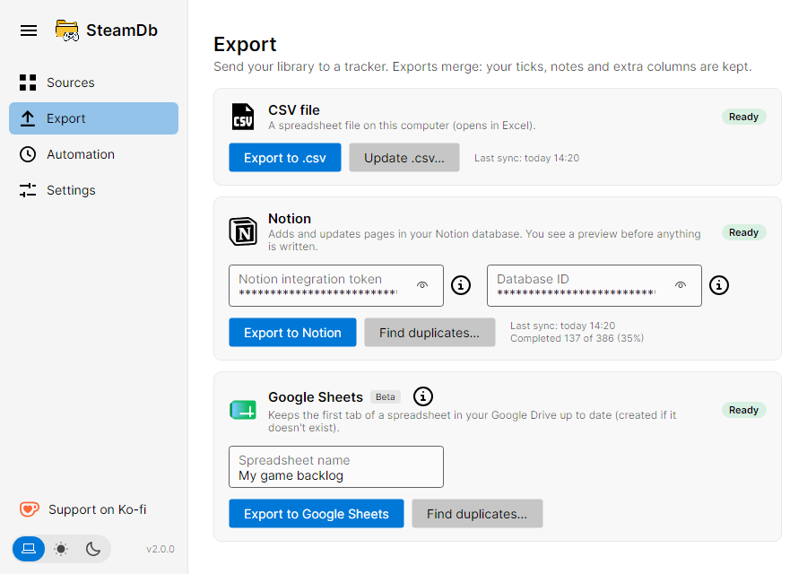
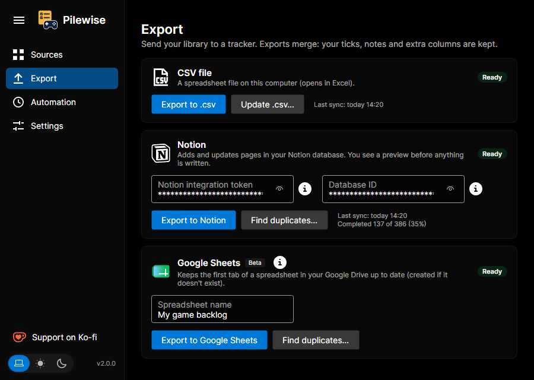
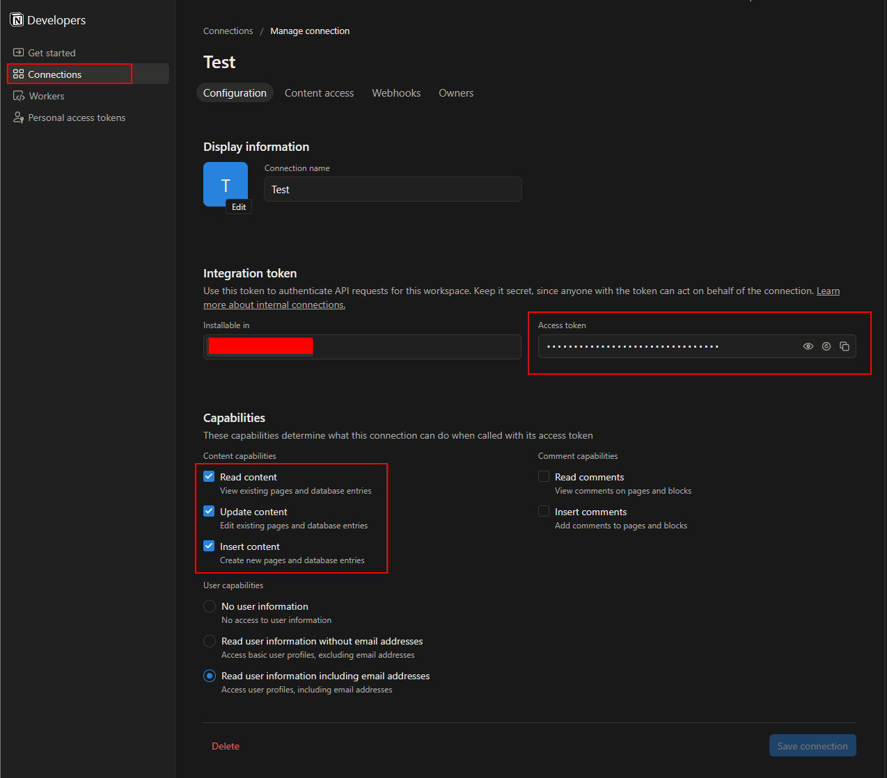
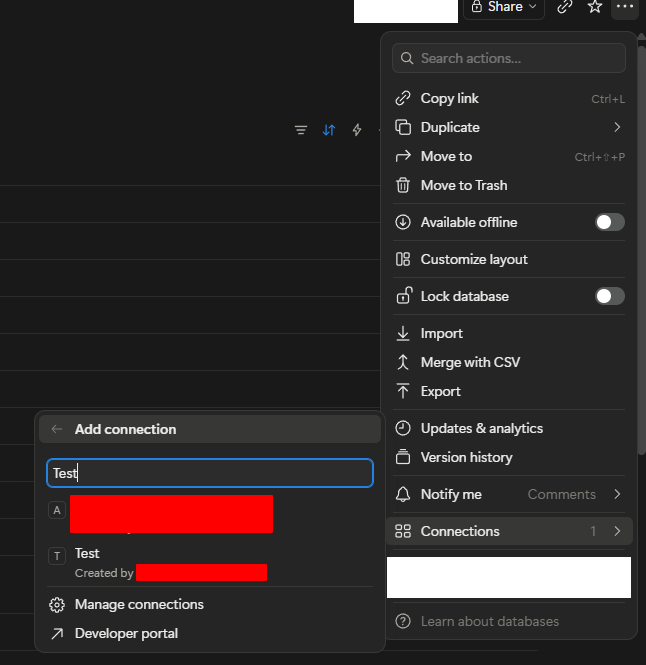
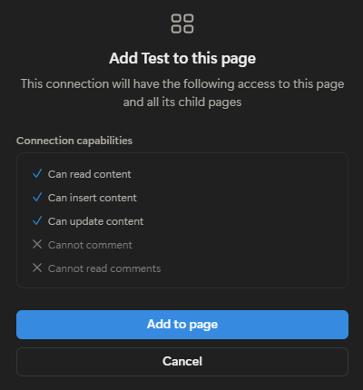
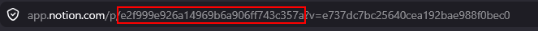
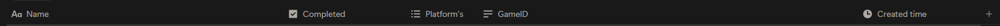

<div align="center">


# SteamDb

**Your whole game library, in one backlog.**

Pull your owned games from **Steam, Epic, GOG and Xbox** and sync them into **Notion**,
**Google Sheets** or a local **CSV**, so you can see what you've completed, what's in
progress, and what you never even started.

[](https://github.com/AleksandrPidlozhevich/SteamDb/releases)
[](https://dotnet.microsoft.com/)
[](https://avaloniaui.net/)
[](#download)
[](LICENSE.txt)

[**Download**](#download) · [**Features**](#features) · [**Connect stores**](#connecting-your-stores) · [**Export**](#export-targets) · [**Privacy**](#privacy)

</div>

<br>

<div align="center">

| Light | Dark |
| :---: | :---: |
|  |  |

</div>

---

## Why SteamDb?

You buy games during sales, and then you forget what you already own and where you bought it.
SteamDb collects every library into **one merged list** and keeps your tracker up to date. A
game you own on two stores becomes one row, tagged with both platforms.

---

## Download

<div align="center">

[](https://github.com/AleksandrPidlozhevich/SteamDb/releases)
[](https://github.com/AleksandrPidlozhevich/SteamDb/releases)
[](https://github.com/AleksandrPidlozhevich/SteamDb/releases)

</div>

From the [latest release](https://github.com/AleksandrPidlozhevich/SteamDb/releases/latest), pick
the file for your system:

| System | File |
| :--- | :--- |
| Windows | `SteamDb-win-x64-Setup.exe` (installer) or `SteamDb-win-x64-Portable.zip` |
| macOS (Apple Silicon, M1 and later) | `SteamDb-osx-arm64-Portable.zip` |
| macOS (Intel) | `SteamDb-osx-x64-Portable.zip` |
| Linux | `SteamDb-linux-x64.AppImage` |

> [!TIP]
> **SteamDb updates itself.** When a new version is out, a banner appears at the top of the
> window. Click **Update & restart** and you're done.

---

## Features

| | |
| --- | --- |
| 🎮 **Four stores, one list** | Fetches owned games from Steam, Epic, GOG and Xbox and merges duplicates across stores. |
| 📤 **Three export targets** | A Notion database, Google Sheets, or a local CSV file. |
| 🔁 **Incremental sync** | Re-running an export reconciles with what's already there. It adds new games and updates platform tags without creating duplicates. |
| ⏹️ **Cancellable** | Every export shows a progress bar with a **Cancel** button. |
| 🔒 **Secure by default** | Store tokens and remembered credentials are cached **encrypted** (DPAPI on Windows, Keychain on macOS, libsecret on Linux) and refreshed automatically. |
| 🌗 **Light & dark themes** | Switch with one click. |
| 💻 **Cross-platform** | One app for Windows, macOS and Linux. |

---

## Getting started

```
 1. Download  ──▶  2. Connect your stores  ──▶  3. Pick a target & export
```

1. **Download** and run the app for your OS (see [Download](#download)).
2. **Connect** at least one store (see [Connecting your stores](#connecting-your-stores)).
3. **Pick an export target** and run the export (see [Export targets](#export-targets)).

---

## Connecting your stores

| Store | How you connect | Login window |
| :--- | :--- | :--- |
|  **Steam** | Steam ID + Web API key | None. Fill in two fields. |
| <picture><source media="(prefers-color-scheme: dark)" srcset="SteamDb/Assets/epic-games-dark.svg"></picture> **Epic Games** | Authorization code | Your **system browser** |
| <picture><source media="(prefers-color-scheme: dark)" srcset="SteamDb/Assets/gog-com-dark.svg"></picture> **GOG** | Automatic | **Embedded** in the app |
| <picture><source media="(prefers-color-scheme: dark)" srcset="SteamDb/Assets/xbox-dark.svg"></picture> **Xbox** | Automatic | **Embedded** in the app |

> [!TIP]
> Once connected, each store's session is cached **encrypted** and refreshed automatically,
> so you won't need to log in again every time.

### Steam

Steam needs your **Steam ID** and a **Steam Web API key**. You don't log in through the app.

<details>
<summary><b>1. Find your Steam ID</b></summary>

<br>

In the Steam desktop app:

1. Click your **username** in the top-right corner.
2. Select **Account details** from the dropdown.
3. Below your display name you'll see your **Steam ID**, a long number (usually 17 digits).
4. Copy and save this number.

</details>

<details>
<summary><b>2. Get your Steam Web API key</b></summary>

<br>

1. Go to the [Steam Web API key page](https://steamcommunity.com/dev/apikey).
2. Sign in to your Steam account if prompted.
3. Accept the **Steam Web API Terms of Use**.
4. Enter a domain name (any name works, e.g. `steamdb-local`) and click **Register**.
5. Your **API key** is displayed as a long alphanumeric string. Copy and save it.

📘 Reference: [Official Steam Web API documentation](https://developer.valvesoftware.com/wiki/Steam_Web_API)

</details>

> [!WARNING]
> **Keep your Steam ID and API key private.** Never share them publicly or commit them to
> version control.

### Epic Games

Epic's login blocks embedded webviews (CAPTCHA), so you log in in your **system browser**:

1. Click **Connect** on the Epic card. Your default browser opens Epic's login page.
2. Sign in. Epic then shows a page with an **authorization code**.
3. Copy the code and paste it into the app. When possible, the app picks it up from the
   clipboard automatically.

### GOG

GOG logs in through an **embedded WebView** inside the app:

1. Click **Connect** on the GOG card. A login window opens.
2. Sign in. The app reads the authorization code from the redirect and closes the window.

### Xbox

Xbox also logs in through an **embedded WebView**:

1. Click **Connect** on the Xbox card. A Microsoft login window opens.
2. Sign in with your Microsoft account. The app reads the token from the redirect and closes
   the window.
3. Game Pass titles are flagged on a best-effort basis.

---

## Export targets

| Target | Needs | Best for |
| :--- | :--- | :--- |
| <picture><source media="(prefers-color-scheme: dark)" srcset="SteamDb/Assets/file-csv-dark.svg"></picture> **CSV** | Nothing | Excel, quick offline lists |
| <picture><source media="(prefers-color-scheme: dark)" srcset="SteamDb/Assets/notion-dark.svg"></picture> **Notion** | Integration token + database ID | A rich, filterable backlog tracker |
|  **Google Sheets** *(beta)* | A Google account | A shared spreadsheet |

### CSV

The simplest target. No account or token needed.

- **Export to CSV** writes the full merged library to a CSV file you pick.
- **Update CSV** merges the current library into an existing CSV. It keeps your completion
  status and doesn't create duplicates.

The file is written as UTF-8 with a BOM so it opens cleanly in Excel.

### Notion

To sync into Notion you need a Notion **integration token**, a **database ID**, and a database
with the **right properties**.

<details>
<summary><b>1. Create an integration and get the token</b></summary>

<br>

1. Go to the [Notion integrations page](https://www.notion.so/profile/integrations).
2. Click **New integration**.
3. Fill in the name and select the workspace where the integration will be used.
4. Copy the **Internal Integration Token** (a long string starting with `ntn_...`).
5. Save this token somewhere safe. You'll need it in the app settings.

🛡️ Grant the integration these capabilities:

- ✅ `Read content`
- ✅ `Update content`
- ✅ `Insert content`

| | | |
| :---: | :---: | :---: |
|  |  |  |

</details>

<details>
<summary><b>2. Share the database with the integration</b></summary>

<br>

**Share the target Notion database** with the integration, the same way you'd share it with a
person. Otherwise the app can't see or write to it.

</details>

<details>
<summary><b>3. Find your database ID</b></summary>

<br>

1. Open your Notion workspace and go to the target database.
2. Look at the URL in your browser.
3. The **database ID** is the part after the last slash and before the question mark `?`.
   It's a 32-character alphanumeric string.



> [!NOTE]
> You copy the **database ID** from the URL, as before. Internally the app uses Notion API
> version `2025-09-03`, which finds the database's data source automatically, so you don't
> need any extra setup.

📘 Reference: [Retrieve a database](https://developers.notion.com/reference/retrieve-database)
· [Retrieve a data source](https://developers.notion.com/reference/retrieve-a-data-source)
· [Upgrading to 2025-09-03](https://developers.notion.com/guides/get-started/upgrade-guide-2025-09-03)

</details>

<details>
<summary><b>4. Required database properties</b></summary>

<br>

The target database **must** have these properties (names are case-sensitive):

| Property | Type | Holds |
| :--- | :--- | :--- |
| `Name` | Title | The game's title |
| `Platform's` | Multi-select | The store(s) the game is owned on (Steam, Epic, GOG, Xbox) |
| `GameID` | Text | Platform-prefixed id(s), e.g. `Steam:236870; GOG:123` |



</details>

### Google Sheets (beta)

Authorization with Google Sheets uses standard Google OAuth.

> [!CAUTION]
> This integration is in **beta**. The authentication flow may sometimes fail, and some
> features may be unstable or unavailable. We're working on it. Thank you for your patience!

---

## Privacy

🔐 SteamDb does **not** collect, store or send any personal data to its developer. Logs and
cached credentials stay on your device, and credentials are encrypted.
See [PRIVACY_POLICY.md](PRIVACY_POLICY.md).

---

## Support the project

If SteamDb saved your backlog, you can buy me a coffee:

<a href="https://ko-fi.com/aliaksandrpidlazhevich"></a>

---

## Feedback and issues

Found a bug or have an idea? [Open an issue](https://github.com/AleksandrPidlozhevich/SteamDb/issues)
or write to **aleksandr.pidlozhevich@gmail.com**.

---

<div align="center">

Released under the [MIT License](LICENSE.txt) · Built with [.NET](https://dotnet.microsoft.com/) and [Avalonia UI](https://avaloniaui.net/)

</div>
